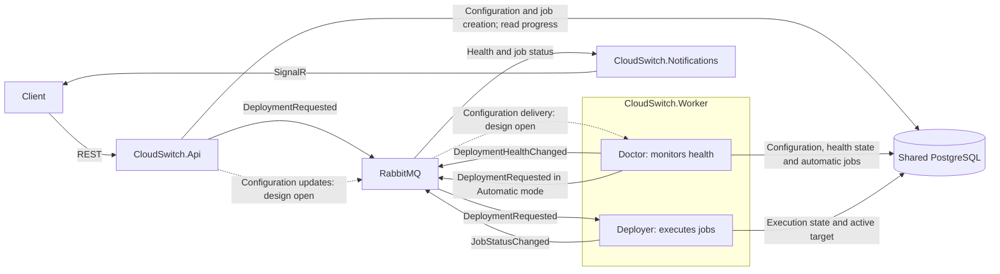

# Architecture

CloudSwitch has three services. **Doctor** and **Deployer** are responsibilities inside `CloudSwitch.Worker`, not separate services.

## Two request paths, one execution flow

- **Manual:** API saves a job and publishes `DeploymentRequested` after the user's request.
- **Automatic:** Doctor confirms failure, reads the current recovery policy, saves a job and publishes the same `DeploymentRequested`.
- **NotifyOnly:** Doctor publishes the health event; Notifications alerts the owner. No automatic job is created.

Doctor publishes `DeploymentHealthChanged` on confirmed failure and recovery in both modes. It makes the policy decision directly; there is no separate Worker consumer translating health events into requests.

Deployer consumes requests from either producer and runs **Terraform provisioning → target health verification → traffic cutover → entrypoint verification**. It publishes job progress and final outcomes. Notifications consumes health/status events on its own queues and sends authorized user updates; it does not execute deployments.

## Shared rules

API and Doctor use the same request schema and durable job-creation rules. Save the job and its outgoing request through an outbox. Deduplicate automatic jobs by deployment/incident and execution by job ID; prevent concurrent migrations of the same deployment. Doctor rechecks current health, provider and policy before requesting recovery.

## Storage ownership

API and Worker share one PostgreSQL database with explicit write ownership:

| Component | Writes |
| --- | --- |
| API | Deployment/target configuration, monitoring/recovery policy and manually submitted jobs. |
| Doctor | Health observations, incidents and automatically submitted jobs. |
| Deployer | Job status/phases, attempts, leases, results and the active target after verified cutover. |
| Notifications | Its own delivery/deduplication state; no job or deployment writes. |

API reads job progress and health directly from PostgreSQL; it does not need event-driven copies. API and Doctor save the initial job plus outgoing request atomically. Deployer saves execution progress plus outgoing status events atomically.

Use separate database roles for API and Worker, and one coordinated schema-migration process. This is a deliberate shared-schema dependency, while service logic stays in its owning project.

## Monitoring configuration

API owns the authoritative settings in PostgreSQL. Event-driven updates are the preferred direction; how Doctor replicas receive them and resume after restart is [open for discussion](discussions/doctor-configuration.md). Per-replica queues and monitoring leases are not requirements.

Doctor checks current policy and active deployment before creating an automatic job. After verified cutover, Deployer records the new active target. Discard observations from an outdated configuration or endpoint.

Run CloudSwitch and its database/broker outside the application's cloud failure domain, not alongside the main application. Recovery must remain possible when that cloud is unavailable.

The diagram describes the agreed design. Contracts and tests exist; the running services and complete migration schema are still pending. See [contracts](contracts.md) and [migration model](domain-model.md).
