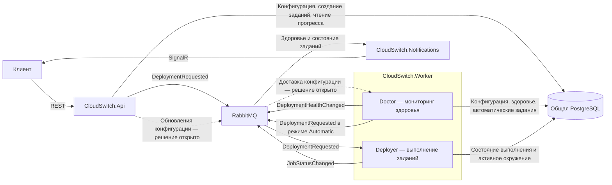

# Архитектура

CloudSwitch состоит из трёх сервисов. **Doctor** и **Deployer** выполняют свои задачи внутри `CloudSwitch.Worker`.

## Два пути создания запроса и общий процесс выполнения

- **Manual** — API сохраняет задание и публикует `DeploymentRequested` по запросу пользователя.
- **Automatic** — Doctor подтверждает сбой, читает текущую политику восстановления, сохраняет задание и публикует такой же `DeploymentRequested`.
- **NotifyOnly** — Doctor публикует событие здоровья, а Notifications уведомляет владельца. Автоматическое задание не создаётся.

Doctor публикует `DeploymentHealthChanged` при подтверждённом сбое и восстановлении в обоих режимах. Он непосредственно применяет политику восстановления. Отдельного обработчика Worker, преобразующего события здоровья в запросы, нет.

Deployer принимает запросы от обоих источников и выполняет **создание инфраструктуры Terraform → проверку здоровья целевого приложения → переключение трафика → проверку публичной точки входа**. Он публикует прогресс и итог задания. Notifications получает события здоровья и состояния из собственных очередей и отправляет обновления авторизованным пользователям.

## Общие правила

API и Doctor используют одну схему запроса и общие правила надёжного создания заданий. Задание и исходящий запрос сохраняются через outbox. Автоматические задания дедуплицируются по развёртыванию и инциденту, выполнение — по ID задания. Одновременные миграции одного развёртывания запрещены. Перед запросом восстановления Doctor повторно проверяет здоровье, провайдера и политику.

## Ответственность за данные

API и Worker используют общую PostgreSQL с явными границами записи.

| Компонент | Записываемые данные |
| --- | --- |
| API | Конфигурация развёртывания и целевого окружения, политика мониторинга и восстановления, ручные задания. |
| Doctor | Результаты проверок здоровья, инциденты, автоматические задания. |
| Deployer | Состояния и фазы заданий, попытки, аренды выполнения, результаты и активное окружение после проверенного переключения. |
| Notifications | Собственное состояние доставки и дедупликации. |

API читает прогресс и здоровье непосредственно из PostgreSQL. API и Doctor атомарно сохраняют начальное задание с исходящим запросом. Deployer атомарно сохраняет прогресс с исходящими событиями состояния.

Для API и Worker используются разные роли БД и один согласованный процесс миграций схемы. Общая схема создаёт осознанную зависимость между сервисами, при этом логика каждого сервиса остаётся в его проекте.

## Конфигурация мониторинга

API хранит актуальные настройки в PostgreSQL. В [начальном варианте](decisions/api-v1.md) Doctor загружает активную конфигурацию при запуске и затем опрашивает ревизии. Доставка через события и координация реплик отложены. Отдельные очереди на реплику и аренды мониторинга не требуются.

Перед созданием автоматического задания Doctor проверяет текущую политику и активное развёртывание. После проверенного переключения Deployer записывает новое активное окружение. Результаты проверок устаревшей конфигурации или endpoint отбрасываются.

CloudSwitch, БД и брокер размещаются вне области отказа облака приложения. Восстановление должно оставаться доступным при отказе этого облака.

[Рабочий API](api.md), общая схема и миграции, контракты и тесты уже существуют. Worker интегрирован с PostgreSQL/RabbitMQ и использует явно включаемые локальные адаптеры симуляции. Реальные облачные адаптеры, мониторинг Doctor и Notifications ожидают реализации. См. [контракты](contracts.md) и [модель миграции](domain-model.md).
